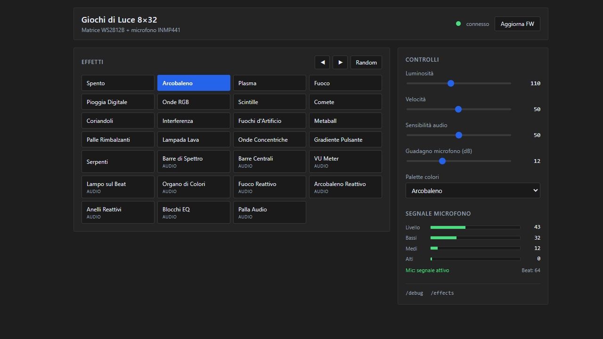

# 🌈 Luce in Ascolto — matrice LED 8×32 che ascolta

**Un pannello di 256 LED che si illumina con 27 giochi di luce e, se vuoi, balla a ritmo della musica che sente nell'aria.**

Il cuore del progetto è una scheda **ESP32-S2 mini**: un piccolo computer grande come un'unghia, con WiFi incorporato. Colleghi una **matrice di LED WS2812B da 8×32 pixel** e un **microfono digitale INMP441**. La scheda analizza il suono in tempo reale (senza internet, senza computer) e decide, pixel per pixel, che colore accendere. Da qualsiasi telefono o PC sulla stessa rete WiFi apri una pagina web e scegli l'effetto, la luminosità, la palette di colori.



> Nella foto: la pagina web reale, servita direttamente dalla scheda. A sinistra i 27 effetti (quelli con l'etichetta `AUDIO` reagiscono al suono), a destra i controlli e il misuratore del segnale del microfono.

| Firmware | Interfaccia | Hardware |
|---|---|---|
|  |  |  |
|  |  |  |

---

## Indice

1. [In 30 secondi (spiegato semplice)](#1-in-30-secondi-spiegato-semplice)
2. [Cosa fa esattamente](#2-cosa-fa-esattamente)
3. [La pagina web, controllo per controllo](#3-la-pagina-web-controllo-per-controllo)
4. [Hardware: cosa comprare e come collegarlo](#4-hardware-cosa-comprare-e-come-collegarlo)
5. [Montaggio passo per passo](#5-montaggio-passo-per-passo)
6. [Installare il software (guida per principianti)](#6-installare-il-software-guida-per-principianti)
7. [Uso quotidiano: effetti e palette](#7-uso-quotidiano-effetti-e-palette)
8. [Come funziona dentro](#8-come-funziona-dentro)
9. [Protocollo di comunicazione (per chi vuole estendere)](#9-protocollo-di-comunicazione-per-chi-vuole-estendere)
10. [Parametri, limiti e valori predefiniti](#10-parametri-limiti-e-valori-predefiniti)
11. [Struttura del repository](#11-struttura-del-repository)
12. [Provare tutto senza la scheda (simulatore)](#12-provare-tutto-senza-la-scheda-simulatore)
13. [Aggiornare il firmware via WiFi (OTA)](#13-aggiornare-il-firmware-via-wifi-ota)
14. [Personalizzare il progetto](#14-personalizzare-il-progetto)
15. [Problemi e soluzioni](#15-problemi-e-soluzioni)
16. [Limiti noti e perché di alcune scelte](#16-limiti-noti-e-perché-di-alcune-scelte)
17. [Credenziali WiFi e privacy](#17-credenziali-wifi-e-privacy)
18. [Domande frequenti](#18-domande-frequenti)
19. [Licenza e crediti](#19-licenza-e-crediti)

---

## 1. In 30 secondi (spiegato semplice)

Immagina un piccolo striscia LED flessibile da 256 LED: **32 colonne e 8 righe**, come un rettangolo luminoso largo e basso. Ogni LED contiene tre minuscoli led (rosso, verde, blu) e un chip che gli dice "accenditi a questo colore". Il tutto è comandato da **un solo filo** di dati: la scheda manda una lunga fila di numeri, uno dopo l'altro, e ogni LED trattiene il suo.

Il progetto fa tre cose:

1. **Illumina** — calcola 27 animazioni diverse (arcobaleno, fuoco, pioggia verde, fuochi d'artificio, serpenti…) e le aggiorna decine di volte al secondo.
2. **Ascolta** — il microfono INMP441 manda alla scheda un flusso continuo di numeri che rappresentano la pressione dell'aria (il suono). Un piccolo compito dedicato li analizza e ne ricava: quanto è forte il suono, quanta energia c'è nei bassi, nei medi e negli alti, e quando arriva un "colpo" (il beat).
3. **Mostra un pannello di controllo** — la scheda crea una rete web: apri l'indirizzo nel browser (per esempio `http://192.168.0.71`) e vedi una pagina con i pulsanti. Ogni tua modifica viaggia alla scheda in pochi millisecondi tramite **WebSocket**, un canale sempre aperto in cui i due lati si scambiano messaggini JSON.

Non serve nessun computer acceso, nessun abbonamento, nessun cloud: **la scheda fa tutto da sola**, e funziona anche se internet non c'è (basta che telefono e scheda siano sulla stessa rete).

---

## 2. Cosa fa esattamente

- **27 effetti** selezionabili (uno è "Spento"), 17 autonomi e 10 audio-reattivi.
- **9 palette di colori** (Arcobaleno, Festa, Oceano, Lava, Foresta, Neon, Tramonto, Ghiaccio, Pastello) che cambiano l'aspetto di molti effetti.
- **Regolazioni in tempo reale**, senza riavviare: luminosità, velocità, sensibilità audio, guadagno del microfono, palette.
- **Cambio automatico casuale** di effetto ogni 30 secondi (on/off con un pulsante).
- **VU-meter** nella pagina: livello, bassi, medi, alti e conteggio dei battiti, aggiornato 10 volte al secondo.
- **Memoria delle impostazioni** nel browser (`localStorage`): quando riapri la pagina ritrovi i tuoi valori.
- **Aggiornamento firmware dall'aria** (OTA): carichi un file `.bin` dal browser, senza attaccare il cavo USB.
- **Diagnostica** (`/debug`): heap libera, RSSI del WiFi, stato del microfono, letture fallite. Serve a capire *perché* qualcosa non va.
- **Fallback Access Point**: se non trova la tua rete WiFi, la scheda crea la sua (`esp32-luci`), così puoi comunque aprirla e sistemare le cose.

---

## 3. La pagina web, controllo per controllo

La pagina è volutamente **minimale**: un pannello scuro, niente fronzoli, niente dipendenze esterne (nessuna CDN: funziona anche con la scheda in modalità Access Point, senza internet). Sono tre file serviti dal filesystem interno della scheda:

| File | Ruolo |
|---|---|
| `data/index.html` | struttura della pagina (titolo, griglia effetti, slider, meter) |
| `data/style.css` | tema scuro "industriale" (grigio #1E1E1E, accento blu, angoli 3 px) |
| `data/app.js` | tutta la logica: WebSocket, griglia effetti, slider, memoria locale |

Ecco gli elementi uno per uno:

| Elemento | Cosa fa |
|---|---|
| **Pallino verde/grigio + "connesso"** | indica se il WebSocket è aperto. Se è grigio, la pagina riprova da sola ogni 2 secondi. |
| **Aggiorna FW** | apre la pagina di aggiornamento (`/update`, chiede la password). |
| **Griglia effetti** | un pulsante per ogni effetto, nome letto da `/effects`. Quelli audio-reattivi hanno sotto la scritta `AUDIO`. Il selezionato diventa blu. |
| **◀ ▶** | effetto precedente / successivo (ciclico: dopo l'ultimo torna al primo). |
| **Random** | accende/spegne il cambio casuale di effetto ogni 30 secondi. |
| **Luminosità** (5–255) | intensità globale applicata a tutti i LED. 110 è il default: già bella viva ma senza assorbire troppa corrente. |
| **Velocità** (1–100) | moltiplicatore del tempo delle animazioni. 50 = velocità nominale, 100 = il doppio, 1 = quasi fermo. |
| **Sensibilità audio** (0–100) | quanto "amplificare" la reazione delle barre/effetti al suono. Non tocca il volume: agisce sulla scala dei valori calcolati. |
| **Guadagno microfono (dB)** (0–36) | guadagno digitale applicato ai campioni prima dell'analisi. Se il microfono sembra sordo, alzalo. 12 dB è il default. |
| **Palette colori** | le 9 palette del firmware (vedi [§7.2](#72-le-9-palette)). |
| **Livello / Bassi / Medi / Alti** | barre 0–100: verde sotto 65, gialla fino a 85, rossa sopra. |
| **Mic: segnale attivo / silenzio** | se negli ultimi 1,2 s è arrivato suono utile. |
| **Beat: N** | numero di impulsi ritmici riconosciuti dall'avvio (testo giallo quando il livello supera 55). |
| **/debug e /effects** | link diretti agli endpoint JSON (utili per curiosi e per il debug). |

> La pagina si adatta anche al telefono: sotto 820 px di larghezza i due pannelli si mettono uno sopra l'altro.

---

## 4. Hardware: cosa comprare e come collegarlo

### 4.1 Lista della spesa

| Pezzo | Specifiche | A cosa serve | Note |
|---|---|---|---|
| **LOLIN S2 mini** | ESP32-S2FN4R2, 4 MB flash, 2 MB PSRAM, USB-C | il "cervello" | Single core 240 MHz, WiFi 2.4 GHz |
| **Matrice WS2812B** | 8 righe × 32 colonne = 256 LED, passo 5 mm | i pixel luminosi | Cablaggio **a serpentina** (vedi sotto) |
| **INMP441** | microfono MEMS I²S, 24 bit | ascolta il suono | Modulo breakout con 6 pin |
| **Alimentatore 5 V** | almeno 3–4 A (ideale 5 A) | alimenta i LED | Un caricatore USB da 2 A **non basta** a piena luminosità |
| **Condensatore elettrolitico** | 1000 µF / 6,3 V | stabilizza i picchi di corrente | Da saldare vicino all'ingresso della matrice |
| **Resistenza** | 330–470 Ω | in serie sul filo dati | Protegge il primo LED da disturbi |
| **Cavi / saldatore** | — | collegamenti | Un filo per GND in comune fra scheda e alimentatore |

**Opzionale ma consigliato**: un level shifter **74AHCT125** se la matrice, con cavi lunghi, mostra colori instabili: il segnale dati a 3,3 V è al limite inferiore della specifica WS2812B.

### 4.2 Schema di collegamento

```
                         +5 V  ────────────────┐
                                               │
   ┌─────────────────────┐                     ├─── 1000 µF ─── GND
   │   LOLIN S2 mini     │                     │
   │                     │                     │
   │  GPIO 5  ───────────┼──[330 Ω]── DIN ─────┴── MATRICE WS2812B 8×32
   │  GND     ───────────┼────────── GND ─────────  (256 LED)
   │  3V3     ───────────┼── VDD                     5 V
   │                     │
   │  GPIO 7  ───────────┼── SCK/BCLK ┐
   │  GPIO 9  ───────────┼── WS/LRCLK ├── INMP441 (microfono I²S)
   │  GPIO 11 ───────────┼── SD        │
   │  3V3     ───────────┼── VDD       │
   │  GND     ───────────┼── GND       │
   │  GND     ───────────┼── L/R ──────┘   (seleziona il canale: a GND = LEFT)
   │                     │
   │  GPIO 15 ─── LED di stato interno (attivo LOW, niente da collegare)
   └─────────────────────┘
```

| Segnale | GPIO ESP32-S2 mini | Dove è definito |
|---|---|---|
| Matrice — DIN (dati) | **5** | `FASTLED_DATA_PIN` in `include/config.h` |
| Microfono — SCK / BCLK | **7** | `I2S_BCLK_PIN` |
| Microfono — WS / LRCLK | **9** | `I2S_WS_PIN` |
| Microfono — SD / DIN | **11** | `I2S_DATA_IN_PIN` |
| Microfono — L/R | GND (canale LEFT) | `I2S_FORCE_CHANNEL` = 2 (AUTO) |
| Microfono — VDD | 3V3 | — |
| LED di stato | **15** | `LED_BUILTIN` |

> **Attenzione al cablaggio della matrice**: la stragrande maggioranza delle matrici 8×32 è cablata **a serpentina**: la prima riga va da sinistra a destra, la seconda da destra a sinistra, la terza di nuovo da sinistra a destra, e così via. Il firmware lo sa già (`MATRIX_SERPENTINE true`). Se il tuo pannello ha un cablaggio diverso, si cambia con una riga: `MATRIX_SERPENTINE false`, oppure `MATRIX_FLIP_X` / `MATRIX_FLIP_Y`.

### 4.3 Alimentazione: la parte che si sottovaluta sempre

256 LED, ognuno con tre led interni, possono assorbire **fino a 60 mA** ciascuno a bianco pieno e luminosità massima: 256 × 60 mA ≈ **15 A**. Non è il caso normale (gli effetti usano colori parziali e luminosità 110, e siamo nell'ordine di 1–3 A), ma l'alimentatore va scelto con margine:

- **3 A** sufficienti per effetti colorati a luminosità media;
- **5 A** per stare tranquilli e poter alzare la luminosità;
- **GND in comune obbligatorio** tra alimentatore, matrice e scheda: senza riferimento comune il segnale dati non viene capito e la matrice lampeggia a caso;
- **1000 µF** vicino alla matrice assorbe i picchi quando 256 LED si accendono insieme;
- **non alimentare la matrice dal pin 5V della scheda**: la scheda non è un alimentatore.

---

## 5. Montaggio passo per passo

1. **Prova la matrice da sola** (facoltativo ma consigliato): collega solo 5 V, GND e DIN, carica il firmware, verifica che i colori scorrano nel verso giusto. Se appaiono speculari o "spezzati", è il cablaggio a serpentina: vedi §4.2.
2. **Saldare il microfono**: quattro fili (SCK, WS, SD, L/R) più alimentazione. Tieni i fili **corti** (meno di 10 cm se possibile): l'I²S lavora a 16 kHz e soffre i disturbi.
3. **Mettere L/R a GND** (canale sinistro). Se il tuo modulo ha il pin flottante e il firmware non sente nulla, il firmware prova da solo anche il canale destro (`I2S_FORCE_CHANNEL 2` = AUTO).
4. **Aggiungere resistenza e condensatore** come nello schema.
5. **Alimentare tutto**: alimentatore → matrice; scheda via USB (per programmarla) o da un secondo alimentatore 5 V.
6. **Fissare il pannello** dietro un diffusore, in una cornice, o semplicemente appoggiato: i LED sono molto luminosi e diretti, meglio non guardarli da vicino a lungo.

---

## 6. Installare il software (guida per principianti)

Serve un computer Windows, macOS o Linux con **una porta USB**. Non serve essere programmatori: si tratta di installare un programma, copiare due valori e premere un pulsante.

### 6.1 Installare VS Code + PlatformIO

1. Scarica **Visual Studio Code** da <https://code.visualstudio.com> e installalo.
2. Apri VS Code → colonna delle estensioni (icona quadrati a sinistra) → cerca **PlatformIO IDE** → *Install*.
3. Al primo avvio PlatformIO scarica da solo compilatore e librerie: la prima volta può volerci qualche minuto.

### 6.2 Aprire il progetto

Scarica questo repository (`Code → Download ZIP` e scompattalo, oppure `git clone`), poi in PlatformIO: **File → Open Folder** → scegli la cartella che contiene `platformio.ini`.

### 6.3 Inserire nome e password del WiFi

Il repository **non contiene** credenziali. Si usano in questo modo:

1. Nella cartella `include/` copia `config_secrets.example.h` e rinomina la copia **`config_secrets.h`**.
2. Aprila e sostituisci:

```c
#define WIFI_SSID     "NOME_DELLA_TUA_RETE"
#define WIFI_PASSWORD "PASSWORD_DELLA_TUA_RETE"
```

3. Salva. `config.h` la legge automaticamente; `config_secrets.h` è in `.gitignore` e non finisce mai su GitHub.

> La rete deve essere **2.4 GHz**: l'ESP32-S2 non supporta il 5 GHz.
> Se preferisci non configurare nulla, salta questo passo: la scheda non troverà la rete e creerà la sua (`esp32-luci`, password `12345678`, indirizzo `http://192.168.4.1`).

### 6.4 Compilare

Dalla cartella del progetto, con il terminale di PlatformIO (o un terminale qualsiasi con `pio` installato):

```bash
pio run
```

Atteso: `SUCCESS`, con un consumo di memoria tipo *RAM 17.8% / Flash 64.8%*.

### 6.5 Primo caricamento (una volta sola, con i pulsanti)

La prima volta la scheda va messa in modalità programmazione a mano:

1. Collega la scheda al PC con un cavo USB **che trasmetta dati** (molti cavi sono solo di ricarica).
2. Tieni premuto **BOOT**, premi e rilascia **RST**, poi rilascia **BOOT**. La scheda ora è in "download mode" (su Windows appare una porta COM con PID `0002`).
3. Carica prima la pagina web, poi il firmware:

```bash
pio run -t uploadfs     # carica HTML/CSS/JS nel filesystem interno
pio run -t upload       # carica il firmware
```

4. ⚡ **Stacca e riattacca il cavo USB** (power-cycle). Non basta premere RST: dopo un upload in download mode il reset via software non è affidabile su questa scheda.
5. Attendi 5 secondi. La scheda si connette al WiFi e accende la matrice con l'effetto Arcobaleno.

> Se il caricamento del filesystem viene saltato, la pagina `/` risponde **404**: è l'errore più comune del primo montaggio (`pio run -t uploadfs`).

### 6.6 Trovare l'indirizzo della scheda

- Guarda il **monitor seriale** (115200 baud) nel primo avvio: stampa righe come
  `[WIFI] Connesso, IP: 192.168.0.71`.
- Oppure cerca nel router la scheda chiamata `espressif` / `Espressif` nella lista dei dispositivi.
- In modalità Access Point l'indirizzo è sempre **192.168.4.1** (connettiti alla rete `esp32-luci`).

### 6.7 Aprire la pagina

Dal browser del telefono o del PC: `http://<indirizzo-della-scheda>` (per esempio `http://192.168.0.71`). Se la pagina si apre ma il pallino resta grigio, controlla di non avere un'altra scheda del browser già connessa allo stesso WebSocket (vedi §16).

### 6.8 Caricamenti successivi (senza pulsanti)

Dopo il primo flash, PlatformIO riesce a resettare la scheda da solo (tecnica *1200 bps touch*):

```bash
pio run -t upload        # solo firmware
pio run -t uploadfs      # solo pagina web
```

Fai comunque un power-cycle del cavo USB dopo l'upload: è l'unico modo per essere sicuro al 100% che stia girando il firmware nuovo (verifica con `/debug` → `uptime_ms` basso).

---

## 7. Uso quotidiano: effetti e palette

### 7.1 I 27 effetti

| # | Nome | Tipo | Cosa si vede |
|---|---|---|---|
| 0 | Spento | — | pannello nero (utile di notte) |
| 1 | Arcobaleno | autonomo | diagonale di colori che scorre all'infinito |
| 2 | Plasma | autonomo | macchie di colore che si fondono, effetto "liquido" |
| 3 | Fuoco | autonomo | fiamme che salgono dal basso, con faville |
| 4 | Pioggia Digitale | autonomo | gocce verdi che scendono con la scia, stile Matrix |
| 5 | Onde RGB | autonomo | tre onde sinusoidali indipendenti su rosso, verde e blu |
| 6 | Scintille | autonomo | puntini colorati che si accendono a caso |
| 7 | Comete | autonomo | cinque palline bianche che rimbalzano lasciando la scia |
| 8 | Coriandoli | autonomo | coriandoli colorati che cadono e si accumulano |
| 9 | Interferenza | autonomo | rumore grigio tipo TV disturbata |
| 10 | Fuochi d'Artificio | autonomo | esplosioni periodiche di particelle con gravità |
| 11 | Metaball | autonomo | tre sfere morbide che si fondono quando si avvicinano |
| 12 | Palle Rimbalzanti | autonomo | palline con gravità che rimbalzano sul fondo |
| 13 | Lampada Lava | autonomo | bolle che salgono e ondeggiano, stile lampada lava |
| 14 | Onde Concentriche | autonomo | anelli che si espandono da centri casuali |
| 15 | Gradiente Pulsante | autonomo | la palette "respira" come un cuore |
| 16 | Serpenti | autonomo | quattro camminatori che serpeggiano lasciando traccia |
| **17** | **Barre di Spettro** | **audio** | 16 colonne, una per banda di frequenza, dai bassi agli alti |
| **18** | **Barre Centrali** | **audio** | come sopra, ma le barre partono dal centro e vanno in alto e in basso |
| **19** | **VU Meter** | **audio** | il pannello si riempie in proporzione al volume, verde → giallo → rosso |
| **20** | **Lampo sul Beat** | **audio** | tutto il pannello lampeggia a ogni colpo di basso |
| **21** | **Organo di Colori** | **audio** | bassi = rosso, medi = verde, alti = blu, miscelati insieme |
| **22** | **Fuoco Reattivo** | **audio** | le fiamme si alzano e si intensificano col volume |
| **23** | **Arcobaleno Reattivo** | **audio** | l'arcobaleno scorre più veloce e si accende col suono |
| **24** | **Anelli Reattivi** | **audio** | un anello parte dal centro a ogni beat |
| **25** | **Blocchi EQ** | **audio** | 16 colonne a segmenti, stile equalizzatore da stereo |
| **26** | **Palla Audio** | **audio** | una sfera si sposta orizzontalmente coi bassi, verticalmente con gli alti, e si gonfia col volume |

> Vuoi un consiglio per la prima accensione? Effetto 1 per verificare i colori, effetto 17 con musica per verificare il microfono, effetto 20 per verificare il riconoscimento dei battiti.

### 7.2 Le 9 palette

| # | Nome | Carattere |
|---|---|---|
| 0 | Arcobaleno | tutti i colori, saturi |
| 1 | Festa | fucsia, arancio, verde, azzurro |
| 2 | Oceano | dal blu notte al bianco-azzurro |
| 3 | Lava | nero → rosso → arancio → bianco caldo |
| 4 | Foresta | verdi profondi e gialli verdi |
| 5 | Neon | magenta, ciano, giallo: colori "da insegna" |
| 6 | Tramonto | viola → rosa → arancio → pesca |
| 7 | Ghiaccio | blu freddi fino al bianco |
| 8 | Pastello | tonalità soft, poco aggressive |

La palette cambia l'aspetto di **Plasma, Gradiente Pulsante, Barre di Spettro, Barre Centrali, Blocchi EQ** e altri effetti che leggono la palette corrente. Il fuoco usa sempre una sua palette "Lava" dedicata.

---

## 8. Come funziona dentro

### 8.1 Lo schema a blocchi

```
 [INMP441] --I2S--> [task audio, FreeRTOS]
                       │  1. legge 256 campioni a 16 kHz (ogni 16 ms)
                       │  2. applica il guadagno in dB
                       │  3. calcola RMS, picco, 16 bande Goertzel, beat
                       ▼
              g_audio  (struct AudioState, protetta da mutex)
                       │  copia coerente
                       ▼
                 g_snap  ─────► [loop() principale]
                                   │  dt × velocità
                                   │  clear_all() → fx[effetto](dt) → FastLED.show()
                                   ▼
                          [Matrice WS2812B 256 LED]

 [Browser] ◄── WebSocket /ws ──► [Firmware]
     │  riceve: {"type":"status",...} ogni 5 s
     │           {"type":"audio",...}  10 volte al secondo
     └─ invia:  {"cmd":"set",...} / {"cmd":"get"}
```

Sulla scheda girano **due attività** (task FreeRTOS) che si dividono l'unico core:

| Task | Priorità | Cosa fa |
|---|---|---|
| `audio_acq` | 1 | legge il microfono e analizza, in continuazione |
| `loopTask` (Arduino) | 1 | disegna l'effetto, gestisce il web, il WiFi, l'OTA |

Hanno la **stessa priorità** di proposito: l'ESP32-S2 è single-core, e un task audio più "furbo" affamerebbe il web server (è successo davvero, vedi §16). Ogni giro entrambi cedono il controllo (`taskYIELD()` / `vTaskDelay(1)`), così anche lo stack di rete LwIP riesce a respirare.

### 8.2 Il viaggio del suono, passo per passo

1. **Acquisizione.** Il microfono è digitale: manda i campioni già quantizzati. Il driver I²S li deposita in memoria tramite DMA, a blocchi di **256 campioni** (`AUDIO_BLOCK_SAMPLES`), a **16 kHz** (`AUDIO_SAMPLE_RATE`). Un blocco ogni 16 ms, cioè circa 60 blocchi al secondo.
2. **Conversione e guadagno.** I campioni arrivano a 24 bit utili dentro una parola da 32; si spostano di 8 bit e si dividono per 8 388 608 per ottenere un numero tra −1 e +1. Poi si moltiplica per il guadagno scelto dall'utente (`gainDb`, da 0 a 36 dB → da ×1 a ×63). Il guadagno si ricalcola **solo quando cambia**, non a ogni campione.
3. **Livello e picco.** RMS (radice della media dei quadrati) dà "quanto è forte" il suono; il picco dà "quanto è arrivato vicino al massimo". Entrambi sono smussati: salgono svelti e scendono piano, così le barre non "tremolano".
4. **Analisi a 16 bande con il filtro di Goertzel.** Invece di una FFT completa, per ognuna delle 16 frequenze si calcola un solo coefficiente, una volta sola all'avvio, e poi ogni campione costa poche operazioni:

   ```
   q0 = coeff * q1 - q2 + campione
   q2 = q1 ; q1 = q0
   energia = q1² + q2² - q1·q2·coeff
   ```

   Le 16 bande sono spaziate in modo **logaritmico** fra 80 Hz e 7 kHz, perché l'orecchio (e la musica) non funziona a passi lineari. Indicativamente:

   | Banda | 0 | 1 | 2 | 3 | 4 | 5 | 6 | 7 | 8 | 9 | 10 | 11 | 12 | 13 | 14 | 15 |
   |---|---|---|---|---|---|---|---|---|---|---|---|---|---|---|---|---|
   | Hz | 80 | 108 | 145 | 196 | 264 | 355 | 479 | 645 | 870 | 1172 | 1579 | 2128 | 2867 | 3863 | 5206 | 7014 |

   Ogni banda sale immediatamente al valore nuovo e scende con calma (fattore 0,25): è il trucco che rende le barre "vive" invece che nervose.
5. **Raggruppamento.** Le bande 0–4 diventano i **bassi**, 5–10 i **medi**, 11–15 gli **alti** (percentuali 0–100 per la UI).
6. **Rilevazione del battito.** Il beat è riconosciuto quando i bassi superano una soglia **e** superano di almeno 1,55 volte la loro media mobile, con un blocco di 140 ms per non contare due volte lo stesso colpo. È un metodo volutamente semplice: funziona bene con musica ritmica, è meno preciso con musica classica o parlato.
7. **Pubblicazione.** I valori finiscono in `g_audio` dentro una sezione critica (mutex). Il loop ne prende una copia coerente in `g_snap`: l'effetto disegnato non vede mai un valore a metà strada.

### 8.3 Il ciclo di disegno

```cpp
clear_all();                       // pannello nero
g_fx[g_params.effect](dt);         // l'effetto riempie i 256 pixel
FastLED.show();                    // manda i dati alla matrice
```

`dt` è il tempo trascorso dall'ultimo frame (limitato a 0,1 s per non fare salti dopo una pausa) moltiplicato per **velocità / 50**. Così tutti gli effetti sono "indipendenti dal frame rate": se un frame dura di più, l'animazione avanza di più, e a velocità 100 va il doppio.

Ogni effetto ha una **firma unica**:

```cpp
static void fx_qualcosa(float dt);
```

e il firmware li chiama da una tabella:

```cpp
static const fx_fn g_fx[] = { fx_off, fx_rainbow, fx_plasma, /* ... */ };
```

Quando cambi effetto, `fx_reset_state()` azzera particelle, code e anelli: nessun effetto "eredita" lo stato del precedente.

### 8.4 Tre scelte che rendono il firmware stabile su questa scheda

- **Zero allocazioni durante il disegno.** Particelle, testine, anelli e buffer sono array `static` preallocati. La heap la usano solo il web server e il JSON, e c'è una guardia che blocca l'invio se la heap libera scende sotto 12 KB.
- **Niente `sinf()` nel loop.** L'ESP32-S2 non ha una FPU vettoriale: le funzioni trigonometriche costano care. C'è una **tabella seno da 512 valori** (`g_sin_lut`) e la funzione `fsin()` che interpola: stesso risultato visivo, una frazione del costo.
- **Timer e stampa "difensivi".** Le stampe seriali passano da `SFP()` / `SFL()`, che non fanno nulla se il monitor non è aperto: sull'ESP32-S2 una `Serial.printf` con il cavo attaccato ma nessun monitor aperto può **bloccare la scheda per sempre** (bug HWCDC). Lo stesso vale per `WiFi.status()`, che viene letto al massimo 10 volte al secondo e messo in cache.

---

## 9. Protocollo di comunicazione (per chi vuole estendere)

Tutto passa da HTTP e da un WebSocket in JSON. Non serve alcuna libreria: bastano `curl`, Postman o la console del browser.

### 9.1 WebSocket `ws://<ip>/ws`

**Scheda → browser**, appena ti connetti (e poi come heartbeat ogni 5 s):

```json
{
  "type": "status",
  "effect": 1,
  "random": false,
  "brightness": 110,
  "speed": 50,
  "sensitivity": 50,
  "gainDb": 12,
  "palette": 0,
  "fxCount": 27,
  "heap": 28400
}
```

**Scheda → browser**, telemetria audio 10 volte al secondo:

```json
{ "type": "audio", "level": 42, "bass": 60, "mid": 30,
  "treble": 20, "beats": 157, "signal": true }
```

`level`, `bass`, `mid`, `treble` sono interi **0–100**; `beats` è il contatore totale dall'avvio; `signal` dice se c'è suono "fresco".

**Browser → scheda**, per cambiare i parametri (tutti i campi sono opzionali, il firmware riporta comunque tutto nei limiti):

```json
{ "cmd": "set", "effect": 5, "brightness": 140, "gainDb": 18 }
```

**Browser → scheda**, per chiedere lo stato:

```json
{ "cmd": "get" }
```

Esempio pronto da incollare nella console del browser (F12 → Console, con la pagina aperta):

```js
const ws = new WebSocket("ws://" + location.host + "/ws");
ws.onopen  = () => ws.send(JSON.stringify({ cmd: "set", effect: 20, brightness: 90 }));
ws.onmessage = (e) => console.log(JSON.parse(e.data));
```

### 9.2 Endpoint HTTP

| Endpoint | Metodo | Risposta |
|---|---|---|
| `/` | GET | la pagina web (da LittleFS) |
| `/effects` | GET | elenco effetti, palette e metadati per la UI |
| `/debug` | GET | diagnostica interna in JSON |
| `/update` | GET | form di aggiornamento OTA (richiede `?pwd=<AP_PASSWORD>`) |
| `/update` | POST | upload `multipart/form-data` del file `.bin` |

```bash
# elenco degli effetti e delle palette
curl http://192.168.0.71/effects

# stato interno: heap, microfono, WiFi
curl http://192.168.0.71/debug
```

Esempio di `/effects` (abbreviato):

```json
{
  "effects": ["Spento", "Arcobaleno", "Plasma", "Fuoco", "..."],
  "palettes": ["Arcobaleno", "Festa", "Oceano", "Lava", "Foresta",
               "Neon", "Tramonto", "Ghiaccio", "Pastello"],
  "firstAudioFx": 17,
  "fxCount": 27,
  "paletteCount": 9
}
```

Esempio di `/debug` su hardware reale:

```json
{
  "heap": 24320, "heap_min": 19840, "heap_largest": 17408, "psram": 2013264,
  "ws_clients": 1, "effect": 17, "random": false,
  "brightness": 110, "speed": 50, "sensitivity": 50, "gain_db": 12,
  "palette": 0, "level": 38, "beats": 412,
  "raw_peak": 486310, "raw0": -1024, "rd_ok": 21455, "rd_fail": 0,
  "uptime_ms": 754321, "rssi": -62, "ip": "192.168.0.71"
}
```

I campi che salvano la vita quando il microfono "non funziona":

| Campo | Significato |
|---|---|
| `rd_ok` / `rd_fail` | letture I²S riuscite / fallite: se `rd_fail` cresce, è un problema di driver o di cablaggio del clock |
| `raw_peak` | il campione più alto (24 bit) dell'ultimo blocco: se è **0** il microfono non manda nulla (canale o alimentazione), se è **grande** ma `level` resta 0 è un problema di guadagno |
| `raw0` | primo campione grezzo, utile per vedere se il segnale è sempre identico (silenzio digitale) |
| `heap_min` | il minimo storico di heap: se scende in modo monotono c'è una perdita di memoria |

---

## 10. Parametri, limiti e valori predefiniti

Questi valori sono definiti **in due posti che devono restare allineati**: `include/config.h` (firmware, che valida comunque tutto) e l'oggetto `PARAM_CONFIG` in `data/app.js` (browser, che limita gli slider).

| Parametro | Min | Max | Default | Note |
|---|---|---|---|---|
| `effect` | 0 | 26 | 1 | indice nella tabella degli effetti; 0 = Spento |
| `random` | — | — | `false` | cambio effetto ogni 30 s (`RANDOM_PERIOD_MS`) |
| `brightness` | 5 | 255 | 110 | applicato da `FastLED.setBrightness()` |
| `speed` | 1 | 100 | 50 | 50 = velocità nominale |
| `sensitivity` | 0 | 100 | 50 | amplifica la reazione audio |
| `gainDb` | 0 | 36 | 12 | guadagno digitale del microfono |
| `palette` | 0 | 8 | 0 | una delle 9 palette |

Altri valori utili in `include/config.h`:

| Costante | Valore | Perché |
|---|---|---|
| `AUDIO_SAMPLE_RATE` | 16000 Hz | buon compromesso fra banda utile (fino a 8 kHz) e costo CPU |
| `AUDIO_BLOCK_SAMPLES` | 256 | 16 ms di audio per blocco |
| `AUDIO_READ_TIMEOUT_MS` | 200 | timeout **finito**: se la DMA si incastra, il task riprova invece di restare bloccato |
| `NUM_BANDS` | 16 | bande Goertzel |
| `AUDIO_TASK_STACK` | 8192 B | stack del task di analisi |
| `RANDOM_PERIOD_MS` | 30000 | intervallo del cambio casuale |

---

## 11. Struttura del repository

```
.
├── platformio.ini          configurazione PlatformIO: scheda, USB, librerie
├── README.md               questo file
├── CLAUDE.md               note tecniche e regole di manutenzione del progetto
├── REPORT.md               storico dei bug risolti e delle verifiche fatte
├── include/
│   ├── config.h            PUNTO UNICO DI VERITÀ: pin, WiFi, limiti, task
│   ├── config_secrets.example.h   modello per le credenziali (versionato)
│   └── config_secrets.h    le tue credenziali vere (NON versionato)
├── src/
│   └── main.cpp            firmware: LUT, palette, 27 effetti, I²S + Goertzel,
│                           WiFi STA/AP, WebSocket, /effects /debug /update
├── data/                   contenuto del filesystem LittleFS (la pagina web)
│   ├── index.html          struttura della pagina
│   ├── style.css           tema scuro
│   └── app.js              client WebSocket e logica dell'interfaccia
├── tools/
│   ├── simulator.py        simulatore del firmware (prova la UI senza scheda)
│   └── requirements.txt    dipendenze Python del simulatore
├── test/                   test storici e appunti di collaudo
└── docs/
    └── img/ui-desktop.png  screenshot usato in questo README
```

---

## 12. Provare tutto senza la scheda (simulatore)

Il repository include un piccolo server Python che **serve la vera pagina web** e parla esattamente il protocollo del firmware (status, audio, set, get, /effects, /debug). Utile per:

- vedere l'interfaccia prima di comprare l'hardware;
- provare modifiche a `index.html` / `app.js` senza riflashare;
- mostrare il progetto a qualcuno.

```bash
pip install -r tools/requirements.txt
python tools/simulator.py                 # tono 1 kHz sulla porta 8080
```

Poi apri <http://localhost:8080>.

Il segnale audio è sintetico, si sceglie con `--mode`:

| Modalità | Cosa simula | Effetti audio che si animano |
|---|---|---|
| `--mode sine --freq 1000` | tono puro a 1 kHz | barre accese al centro |
| `--mode sine --freq 80` | tono basso | bassi pieni, beat continui |
| `--mode noise` | rumore "musicale" | tutte le bande movimentate |
| `--mode silence` | silenzio | UI ferma, per controllare il layout |
| `--mode clipping` | segnale al massimo | VU meter sempre al 100% |

Opzioni utili: `--port 8099`, `--host 0.0.0.0` (per aprirlo da un altro dispositivo della rete).

> Il simulatore **non** disegna i LED (non ci sono LED): riproduce solo interfaccia e protocollo. Gli effetti veri si vedono solo sull'hardware.

---

## 13. Aggiornare il firmware via WiFi (OTA)

Ci sono tre strade. La più comoda, senza cavo:

1. Apri **`http://<ip>/update?pwd=<AP_PASSWORD>`** (la password è `12345678` se non l'hai cambiata).
2. Scegli il tipo di file:
   - **Firmware (.bin)** → file `.pio/build/lolin_s2_mini/firmware.bin`
   - **Filesystem LittleFS (.bin)** → file `.pio/build/lolin_s2_mini/littlefs.bin`
3. *Carica e Installa*. La barra di avanzamento arriva al 100%, la scheda si riavvia.
4. Dopo l'aggiornamento fai un **power-cycle del cavo USB** per un avvio pulito (il riavvio "caldo" dopo l'OTA può lasciare il WiFi confuso).

In alternativa, con PlatformIO e protocollo `espota` (porta 3232, password = `AP_PASSWORD`):

```bash
pio run -t upload   --upload-port <IP> --upload-protocol espota --upload-auth=12345678
pio run -t uploadfs --upload-port <IP> --upload-protocol espota --upload-auth=12345678
```

I file `.bin` si generano con `pio run` (firmware) e `pio run -t buildfs` (filesystem).

---

## 14. Personalizzare il progetto

### 14.1 Aggiungere un tuo effetto

In `src/main.cpp`, accanto agli altri effetti:

```cpp
// 27 - Onda che scorre dal centro (esempio didattico)
static void fx_my_wave(float dt) {
    static float t = 0.0f;
    t += dt;
    for (uint8_t y = 0; y < FASTLED_MATRIX_H; y++) {
        for (uint8_t x = 0; x < FASTLED_MATRIX_W; x++) {
            float d = (float)x - 15.5f;
            uint8_t v = (uint8_t)(128.0f + 127.0f * fsin(d * 0.4f - t * 3.0f));
            px(x, y, CHSV((uint8_t)(x * 8), 255, v));
        }
    }
}
```

Poi due modifiche obbligatorie:

```cpp
// 1. dichiarazione (con le altre)
static void fx_my_wave(float dt);

// 2. registrazione nella tabella
static const fx_fn g_fx[] = { /* ... */ fx_audio_ball, fx_my_wave };
static const char *g_fx_names[] = { /* ... */ "Palla Audio", "Onda dal Centro" };
```

Fine: il firmware calcola `FX_COUNT` da solo e `/effects` aggiorna la pagina, che ricostruisce la griglia dei pulsanti senza toccare l'HTML. Se il nuovo effetto è audio-reattivo, mettilo **dopo** gli altri e aggiorna `FIRST_AUDIO_FX` (oggi 17) così la UI mostra l'etichetta `AUDIO` anche a lui.

Regole d'oro per un effetto che non faccia impazzire la scheda:

- usa `fsin()` invece di `sinf()`, `fclamp()` invece di `std::clamp`;
- niente `malloc`, niente `new`;
- niente `delay()` dentro l'effetto: è il loop a cadenzare i frame;
- ricordati che la matrice è **32 larga × 8 alta** e che `px(x, y, colore)` gestisce già la serpentina.

### 14.2 Cambiare pin, dimensioni o microfono

Tutto in `include/config.h`: `FASTLED_DATA_PIN`, `FASTLED_MATRIX_W`, `FASTLED_MATRIX_H`, `MATRIX_SERPENTINE`, `MATRIX_FLIP_X/Y`, i tre pin I²S e `I2S_FORCE_CHANNEL` (`0` = solo LEFT, `1` = solo RIGHT, `2` = AUTO).

> Attenzione: cambiare `FASTLED_MATRIX_W/H` funziona, ma alcuni effetti hanno costanti tarate sugli 8 pixel di altezza (per esempio i fuochi d'artificio e l'energia del fuoco): potrebbero risultare "stretti" o "larghi". Sono valori facili da ritoccare leggendo il codice.

### 14.3 Cambiare l'effetto all'accensione

In `setup()`, `g_params.effect = 1;` (Arcobaleno). Metti il numero dell'effetto che preferisci.

---

## 15. Problemi e soluzioni

| Sintomo | Causa più probabile | Soluzione |
|---|---|---|
| Aprendo `/` vedo **404** | il filesystem non è stato caricato | `pio run -t uploadfs`, poi power-cycle |
| La pagina non si apre affatto | scheda su un'altra rete, IP cambiato, WiFi 5 GHz | guarda il monitor seriale all'avvio per l'IP; usa solo reti 2.4 GHz |
| Non compare nessuna porta COM | cavo "solo ricarica", scheda non in download mode | prova un altro cavo USB; tieni premuto BOOT, premi RST, rilascia |
| Dopo l'upload sembra girare il firmware vecchio | reset RTS non affidabile su questo hardware | **stacca e riattacca la USB**; controlla `uptime_ms` su `/debug` |
| La matrice resta spenta | effetto "Spento", luminosità al minimo, DIN scollegato | scegli un altro effetto; alza la luminosità; controlla il filo dati e il GND comune |
| Colori sbagliati o casaccio | ordine dei colori (GRB/RGB) o alimentazione instabile | verifica `GRB` in `FastLED.addLeds<...>`; aggiungi il condensatore; accorcia i fili |
| Il pannello "trema" o lampeggia a caso | alimentatore debole o massa non comune | alimentatore più potente, GND comune, condensatore |
| **Il microfono segna sempre 0** | pin L/R flottante → il modulo trasmette sull'altro canale | lascia `I2S_FORCE_CHANNEL 2` (AUTO), oppure forza `0`/`1`; controlla `raw_peak` su `/debug` |
| Il segnale c'è ma gli effetti non reagiscono | guadagno troppo basso o sensibilità a 0 | alza `Guadagno microfono` e `Sensibilità audio` |
| La pagina si scollega e si riconnette | WiFi debole o troppi client collegati | avvicinati al router; usa una sola scheda del browser sulla pagina |
| Gli effetti rallentano molto | heap bassa o rete che satura la scheda | chiudi schede extra; riavvia; controlla `heap` su `/debug` |
| Aggiornamento OTA → errore 400 | manca `?pwd=...` o file sbagliato | riapri `/update?pwd=12345678`, usa `firmware.bin` per il tipo *Firmware* |
| Dopo OTA non torna il WiFi | riavvio "caldo" con lo stack di rete bloccato | power-cycle USB: il firmware nuovo è comunque valido |
| Vedo `No hardware SPI pins defined` in compilazione | messaggio **normale**: la matrice è pilotata via bit-bang | ignoralo |

---

## 16. Limiti noti e perché di alcune scelte

Questi non sono difetti da correggere, ma il risultato di scelte fatte (e verificate) su questa scheda:

- **Un solo client WebSocket consigliato.** L'ESP32-S2 ha poca RAM interna e un solo core: due schede del browser aperte sulla pagina possono far saturare i buffer di rete. Se il pallino resta grigio, chiudi le altre schede.
- **Sample rate fisso a 16 kHz.** Copre tutto ciò che serve per gli effetti (fino a 7 kHz analizzati) e lascia CPU al disegno e al web server.
- **Niente FFT, ma Goertzel a 16 bande.** L'obiettivo non è uno spettrogramma da laboratorio: è avere 16 numeri stabili, 60 volte al secondo, costando quasi nulla.
- **`FastLED` fissato alla versione 3.5.0.** La 3.6.0 non compila su ESP32-S2 con questo core (usa `ADC_WIDTH_BIT_12`, che su S2 non esiste).
- **`platform = espressif32@6.3.1` fissato.** Con questo core l'I²S usa l'API "legacy"; le API nuove (`driver/i2s_std.h`) richiedono IDF 5 e quindi un core diverso, con altre rotture da sistemare.
- **Vecchio formato di build USB.** `build_flags` deve stare **tutto su una riga** in `platformio.ini`: con PlatformIO su Windows la forma indentata su più righe viene scartata in silenzio e la porta USB CDC non compare. Nel codice ci sono guardie `#error` che fermano la compilazione se i flag mancano.
- **Stampante seriale "protetta".** `SFP()`/`SFL()` evitano il deadlock dell'HWCDC dell'ESP32-S2 quando il monitor non è aperto.
- **Guardia sulla heap a 12 KB.** Se la memoria interna libera scende sotto quella soglia, il firmware salta l'invio dei frame invece di rischiare un crash.
- **La matrice non ha un frame buffer esterno.** Lo stato degli effetti è statico: niente immagini, solo matematica.

---

## 17. Credenziali WiFi e privacy

- Le credenziali **non sono nel repository**. Stanno in `include/config_secrets.h`, che è in `.gitignore`; nel repo c'è solo il modello `config_secrets.example.h`.
- La pagina web **non ha login** per i comandi: chi è sulla tua rete può cambiare effetto e luminosità. È un oggetto domestico, non un servizio pubblico: **non esporlo su internet**.
- L'unica cosa protetta da password è l'aggiornamento firmware (`/update?pwd=...`, password = `AP_PASSWORD`, default `12345678`): **cambiala** se la scheda sta in un posto condiviso.
- Nessun dato esce dalla rete locale: la scheda non contatta nessun server, non manda statistiche, non ha telemetria. L'unica cosa che "esce" sono i pacchetti WiFi verso il tuo router.
- Le impostazioni dell'interfaccia sono salvate **nel tuo browser** (`localStorage`, chiave `giochiluce_8x32_v1`), non sulla scheda: se cambi dispositivo riparti dai valori predefiniti.

---

## 18. Domande frequenti

**Serve internet?**
No. Solo una rete WiFi locale (o direttamente l'Access Point della scheda).

**Posso usarlo senza WiFi?**
Sì: la scheda crea la rete `esp32-luci` e risponde su `http://192.168.4.1`. Il firmware funziona anche con il WiFi rotto, gli effetti autonomi girano comunque.

**Posso comandarlo dal telefono?**
Sì, è esattamente a cosa serve la pagina web: apri l'IP della scheda dal browser del telefono.

**Quanti LED posso mettere?**
Il limite pratico è la RAM (un byte per canale per LED) e la corrente. 256 pixel occupano 768 byte: si potrebbe salire, ma gli effetti sono tarati su 8×32 e l'alimentazione diventa il vero problema.

**Perché il microfono sente poco?**
L'INMP441 non ha guadagno hardware: alza `Guadagno microfono` (fino a 36 dB) e `Sensibilità audio`. Se `raw_peak` su `/debug` è 0, è un problema di canale o di cablaggio, non di guadagno.

**Il beat non viene riconosciuto su questa canzone.**
La rilevazione è volutamente semplice (bassi sopra la media mobile). Funziona bene su musica con cassa in evidenza; su brani acustici o parlato può essere pigra.

**Come torno alle impostazioni iniziali?**
Nella pagina, cancella i dati del sito (o svuota `localStorage`): al successivo caricamento la pagina chiede lo stato alla scheda. Per i valori del firmware, riavvia la scheda: i default sono in `config.h`.

**Posso comandare due pannelli?**
Servirebbero due schede: questo firmware gestisce una matrice su un solo pin dati. In alternativa si può comandare la stessa matrice da più browser, ma è sconsigliato (§16).

---

## 19. Licenza e crediti

Progetto personale, pubblicato a scopo **didattico e hobbistico**. Non è associata una licenza esplicita: se vuoi riutilizzarlo in un tuo prodotto o pubblicarlo, apri una *issue* e parliamone.

Tecnologie usate: [PlatformIO](https://platformio.org), [Arduino core for ESP32](https://github.com/espressif/arduino-esp32), [FastLED](https://github.com/FastLED/FastLED), [ESPAsyncWebServer](https://github.com/me-no-dev/ESPAsyncWebServer), [ArduinoJson](https://arduinojson.org), [aiohttp](https://docs.aiohttp.org) per il simulatore.

Se costruisci il pannello, mandami una foto: è il motivo per cui questo progetto esiste. ✨
